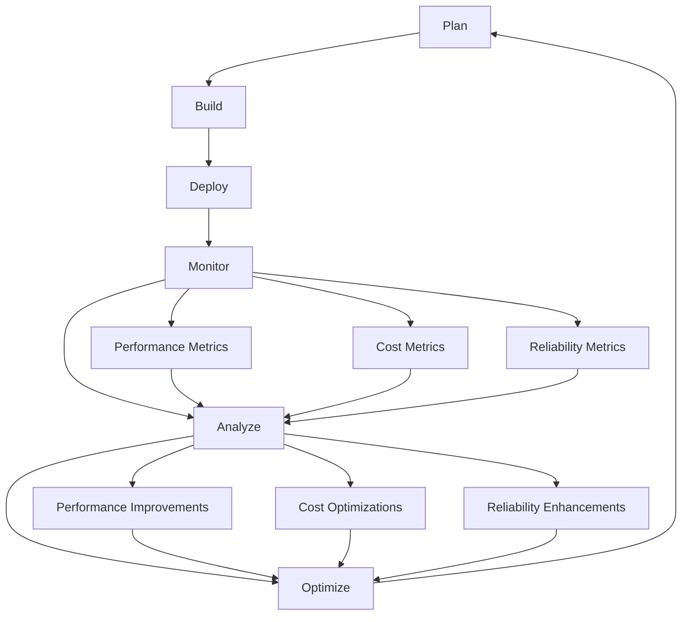

Sự hội tụ của DevOps và FinOps thể hiện sự thay đổi cơ bản từ "chỉ vận chuyển" sang "vận chuyển thông minh". Sự phát triển này thừa nhận rằng trong môi trường dựa trên đám mây, cách bạn xây dựng và triển khai phần mềm sẽ tác động trực tiếp đến cả hiệu quả hoạt động và tính bền vững tài chính.

## Từ tốc độ đến vận tốc bền vững

DevOps truyền thống tập trung chủ yếu vào tốc độ phân phối và độ tin cậy. FinOps bổ sung khía cạnh còn thiếu về hiệu quả chi phí, tạo ra một khung tối ưu hóa hoàn chỉnh hơn.

### Sự phát triển của số liệu kỹ thuật

Các nhóm DevOps thường tối ưu hóa cho:

- Tần suất triển khai
- Thời gian thực hiện các thay đổi
- Thời gian trung bình để phục hồi
- Thay đổi tỷ lệ thất bại

Các nhóm DevOps hỗ trợ FinOps bổ sung thêm:

- Chi phí mỗi lần triển khai
- Tỷ lệ hiệu quả tài nguyên
- Chi phí trên mỗi người dùng/giao dịch
- Số liệu giảm thiểu chất thải

Bộ số liệu mở rộng này không làm chậm tiến độ của các nhóm - nó giúp họ đưa ra quyết định đánh đổi tốt hơn và tránh nợ kỹ thuật biểu hiện dưới dạng kém hiệu quả về chi phí.

### Mô hình mở rộng bền vững

Xem xét cách các nguyên tắc FinOps nâng cao hoạt động DevOps truyền thống:

```python
# Traditional DevOps: Focus on functionality and performance
# FinOps-Enhanced DevOps: Add cost awareness to all decisions

class SmartDeploymentStrategy:
    def __init__(self):
        self.performance_targets = {
            'response_time_p95': 200,  # milliseconds
            'throughput_rps': 1000,    # requests per second
            'availability': 99.9       # percentage
        }

        # FinOps enhancement: Add cost constraints
        self.cost_constraints = {
            'max_cost_per_user': 0.10,    # dollars per month
            'max_infrastructure_cost': 5000,  # dollars per month
            'target_utilization': 70      # percentage
        }

    def select_deployment_configuration(self, expected_load):
        """Select optimal configuration balancing performance and cost"""

        configurations = [
            {
                'name': 'cost_optimized',
                'instances': self.calculate_minimum_instances(expected_load),
                'instance_type': 't3.medium',
                'estimated_cost': 450,
                'performance_score': 85
            },
            {
                'name': 'balanced',
                'instances': self.calculate_balanced_instances(expected_load),
                'instance_type': 'm5.large',
                'estimated_cost': 650,
                'performance_score': 95
            },
            {
                'name': 'performance_optimized',
                'instances': self.calculate_performance_instances(expected_load),
                'instance_type': 'm5.xlarge',
                'estimated_cost': 1200,
                'performance_score': 99
            }
        ]

        # FinOps decision framework: Choose based on cost-performance ratio
        best_config = self.optimize_cost_performance_ratio(configurations, expected_load)

        return best_config

    def optimize_cost_performance_ratio(self, configurations, expected_load):
        """Find the configuration with the best cost-performance ratio"""

        scored_configs = []

        for config in configurations:
            # Calculate cost per unit of performance
            cost_efficiency = config['performance_score'] / config['estimated_cost']

            # Check if it meets cost constraints
            cost_per_user = config['estimated_cost'] / expected_load
            meets_constraints = cost_per_user <= self.cost_constraints['max_cost_per_user']

            scored_configs.append({
                **config,
                'cost_efficiency': cost_efficiency,
                'meets_constraints': meets_constraints,
                'cost_per_user': cost_per_user
            })

        # Filter to only configurations that meet constraints
        valid_configs = [c for c in scored_configs if c['meets_constraints']]

        if not valid_configs:
            print("Warning: No configuration meets cost constraints!")
            return scored_configs[0]  # Return cheapest as fallback

        # Return the most cost-efficient valid configuration
        return max(valid_configs, key=lambda x: x['cost_efficiency'])

    def calculate_minimum_instances(self, expected_load):
        """Calculate minimum instances needed for the load"""
        # Simplified calculation - replace with actual capacity planning
        return max(2, expected_load // 500)

    def calculate_balanced_instances(self, expected_load):
        """Calculate balanced instance count with buffer"""
        return max(2, int(expected_load // 400 * 1.25))

    def calculate_performance_instances(self, expected_load):
        """Calculate instances for optimal performance"""
        return max(3, int(expected_load // 300 * 1.5))

# Example usage
strategy = SmartDeploymentStrategy()
optimal_config = strategy.select_deployment_configuration(expected_load=1000)

print(f"Selected configuration: {optimal_config['name']}")
print(f"Cost efficiency score: {optimal_config['cost_efficiency']:.3f}")
print(f"Monthly cost: ${optimal_config['estimated_cost']}")
print(f"Cost per user: ${optimal_config['cost_per_user']:.3f}")
```

## Quy trình tối ưu hóa tích hợp

FinOps và DevOps chia sẻ các nguyên tắc chung tạo nên các điểm tích hợp tự nhiên.

### Chu kỳ cải tiến liên tục

Cả hai phương pháp đều nhấn mạnh đến việc cải tiến liên tục thông qua đo lường và lặp lại:



### Tự động hóa và cơ sở hạ tầng dưới dạng mã

FinOps nâng cao Cơ sở hạ tầng dưới dạng Mã với nhận thức về chi phí:

```terraform
# Enhanced Terraform module with cost optimization built-in
# terraform/modules/cost-aware-web-app/main.tf

variable "environment" {
  description = "Environment name (dev, staging, prod)"
  type        = string
}

variable "expected_users" {
  description = "Expected number of daily active users"
  type        = number
}

variable "cost_budget" {
  description = "Monthly cost budget in USD"
  type        = number
}

# Cost-aware configuration based on environment and budget
locals {
  environment_configs = {
    dev = {
      instance_type     = "t3.small"
      min_size         = 1
      max_size         = 2
      enable_spot      = true
      storage_type     = "gp3"
      multi_az         = false
    }
    staging = {
      instance_type     = "t3.medium"
      min_size         = 1
      max_size         = 3
      enable_spot      = true
      storage_type     = "gp3"
      multi_az         = false
    }
    prod = {
      instance_type     = "m5.large"
      min_size         = 2
      max_size         = 10
      enable_spot      = false
      storage_type     = "gp3"
      multi_az         = true
    }
  }

  config = local.environment_configs[var.environment]

  # Calculate if we need to adjust for budget constraints
  estimated_monthly_cost = local.config.min_size * 730 * 0.096  # Rough calculation
  needs_cost_optimization = local.estimated_monthly_cost > var.cost_budget

  # Adjust configuration if over budget
  final_config = local.needs_cost_optimization ? {
    instance_type = var.environment == "prod" ? "t3.large" : "t3.small"
    min_size     = 1
    max_size     = local.config.max_size
    enable_spot  = var.environment != "prod" ? true : local.config.enable_spot
    storage_type = "gp3"
    multi_az     = var.environment == "prod" ? true : false
  } : local.config
}

# Auto Scaling Group with cost-optimized configuration
resource "aws_autoscaling_group" "web" {
  name                = "${var.environment}-web-asg"
  vpc_zone_identifier = var.subnet_ids
  target_group_arns   = [aws_lb_target_group.web.arn]
  health_check_type   = "ELB"

  min_size         = local.final_config.min_size
  max_size         = local.final_config.max_size
  desired_capacity = local.final_config.min_size

  # Use mixed instances policy for cost optimization
  mixed_instances_policy {
    launch_template {
      launch_template_specification {
        launch_template_id = aws_launch_template.web.id
        version           = "$Latest"
      }

      # Cost optimization: Use multiple instance types
      override {
        instance_type = local.final_config.instance_type
      }

      # Add spot instances for non-production
      dynamic "override" {
        for_each = local.final_config.enable_spot ? [1] : []
        content {
          instance_type = local.final_config.instance_type
          spot_max_price = "0.05"  # Set maximum spot price
        }
      }
    }

    instances_distribution {
      on_demand_base_capacity                  = var.environment == "prod" ? 1 : 0
      on_demand_percentage_above_base_capacity = var.environment == "prod" ? 50 : 0
      spot_allocation_strategy                 = "diversified"
    }
  }

  # Enhanced tagging for cost attribution
  tag {
    key                 = "Name"
    value               = "${var.environment}-web-server"
    propagate_at_launch = true
  }

  tag {
    key                 = "Environment"
    value               = var.environment
    propagate_at_launch = true
  }

  tag {
    key                 = "CostCenter"
    value               = "engineering"
    propagate_at_launch = true
  }

  tag {
    key                 = "ExpectedUsers"
    value               = var.expected_users
    propagate_at_launch = true
  }

  tag {
    key                 = "CostBudget"
    value               = var.cost_budget
    propagate_at_launch = true
  }
}

# Cost monitoring and alerting
resource "aws_cloudwatch_metric_alarm" "cost_budget_alarm" {
  alarm_name          = "${var.environment}-cost-budget-alarm"
  comparison_operator = "GreaterThanThreshold"
  evaluation_periods  = "1"
  metric_name         = "EstimatedCharges"
  namespace           = "AWS/Billing"
  period              = "86400"
  statistic           = "Maximum"
  threshold           = var.cost_budget * 0.8  # Alert at 80% of budget
  alarm_description   = "Cost approaching budget limit"

  dimensions = {
    Currency = "USD"
  }

  alarm_actions = [aws_sns_topic.cost_alerts.arn]
}

# Output cost estimation for transparency
output "estimated_monthly_cost" {
  description = "Estimated monthly cost for this configuration"
  value = {
    base_cost = local.estimated_monthly_cost
    optimized = local.needs_cost_optimization
    final_estimate = local.needs_cost_optimization ? local.estimated_monthly_cost * 0.7 : local.estimated_monthly_cost
  }
}
```

## Chuyển đổi tổ chức

Sự tích hợp của FinOps và DevOps thúc đẩy những thay đổi lớn hơn trong tổ chức, mang lại lợi ích cho cả năng suất kỹ thuật và tính bền vững của doanh nghiệp.

### Phá vỡ silo

Các tổ chức truyền thống thường tách biệt các mối quan tâm:

- Kỹ thuật tập trung vào tính năng và hiệu suất
- Hoạt động xử lý cơ sở hạ tầng và độ tin cậy
- Tài chính quản lý ngân sách và kiểm soát chi phí

DevOps hỗ trợ FinOps tạo ra trách nhiệm chung:

```python
# Example: Shared responsibility matrix for cloud resources

class SharedResponsibilityModel:
    def __init__(self):
        self.responsibilities = {
            'cost_budgeting': {
                'primary': 'finance',
                'secondary': ['engineering_leads', 'devops'],
                'informed': ['individual_engineers']
            },
            'cost_monitoring': {
                'primary': 'devops',
                'secondary': ['finance', 'engineering_leads'],
                'informed': ['individual_engineers']
            },
            'resource_optimization': {
                'primary': 'individual_engineers',
                'secondary': ['devops', 'engineering_leads'],
                'informed': ['finance']
            },
            'cost_allocation': {
                'primary': 'devops',
                'secondary': ['finance'],
                'informed': ['engineering_leads', 'individual_engineers']
            },
            'budget_variance_analysis': {
                'primary': 'finance',
                'secondary': ['engineering_leads'],
                'informed': ['devops', 'individual_engineers']
            }
        }

    def get_responsibility_for_role(self, role):
        """Get all responsibilities for a specific role"""
        role_responsibilities = {
            'primary': [],
            'secondary': [],
            'informed': []
        }

        for responsibility, owners in self.responsibilities.items():
            if owners['primary'] == role:
                role_responsibilities['primary'].append(responsibility)
            elif role in owners['secondary']:
                role_responsibilities['secondary'].append(responsibility)
            elif role in owners['informed']:
                role_responsibilities['informed'].append(responsibility)

        return role_responsibilities

    def print_role_responsibilities(self, role):
        """Print formatted responsibilities for a role"""
        responsibilities = self.get_responsibility_for_role(role)

        print(f"\n📋 RESPONSIBILITIES FOR: {role.upper().replace('_', ' ')}")
        print("=" * 50)

        if responsibilities['primary']:
            print("🎯 PRIMARY RESPONSIBILITIES:")
            for resp in responsibilities['primary']:
                print(f"   • {resp.replace('_', ' ').title()}")

        if responsibilities['secondary']:
            print("\n🤝 SUPPORTING RESPONSIBILITIES:")
            for resp in responsibilities['secondary']:
                print(f"   • {resp.replace('_', ' ').title()}")

        if responsibilities['informed']:
            print("\n📢 STAY INFORMED ABOUT:")
            for resp in responsibilities['informed']:
                print(f"   • {resp.replace('_', ' ').title()}")

# Example usage
model = SharedResponsibilityModel()

# Show responsibilities for different roles
for role in ['individual_engineers', 'devops', 'engineering_leads', 'finance']:
    model.print_role_responsibilities(role)
```

### Chia sẻ kiến thức và học tập

Tạo lộ trình học tập giúp xây dựng cả khả năng DevOps và FinOps:

```markdown
# DevOps + FinOps Learning Path

## Foundation Level (Month 1-2)

### DevOps Engineers

- [ ] Understanding cloud billing models
- [ ] Basic cost attribution with tagging
- [ ] Using cloud cost management consoles
- [ ] Implementing cost alerts and budgets

### Finance Teams

- [ ] Understanding cloud infrastructure basics
- [ ] DevOps workflow fundamentals
- [ ] Cloud resource lifecycle management
- [ ] Engineering productivity metrics

## Intermediate Level (Month 3-4)

### Cross-Functional Skills

- [ ] Cost optimization techniques
- [ ] Infrastructure as Code for cost management
- [ ] Implementing cost-aware CI/CD pipelines
- [ ] Advanced cost allocation strategies

## Advanced Level (Month 5-6)

### Specialized Focus

- [ ] Building cost optimization into architecture design
- [ ] Advanced automation for cost management
- [ ] Cultural change management for cost awareness
- [ ] Strategic cost planning and forecasting

## Ongoing Development

### Quarterly Objectives

- [ ] Cross-team cost optimization projects
- [ ] Innovation challenges combining efficiency and performance
- [ ] Knowledge sharing sessions between teams
- [ ] Continuous improvement of FinOps processes
```

## Nhìn về tương lai: Tương lai của giao hàng thông minh

Việc tích hợp FinOps và DevOps chỉ là bước khởi đầu. Một số xu hướng sẽ định hình cách các nhóm vận chuyển phần mềm một cách thông minh:

### Tối ưu hóa dựa trên AI

Học máy sẽ ngày càng tự động hóa các quyết định tối ưu hóa chi phí:

- Dự đoán tỷ lệ dựa trên mô hình sử dụng và chi phí
- Đề xuất định cỡ tài nguyên phù hợp tự động
- Vị trí khối lượng công việc thông minh trên các vùng đám mây và nhà cung cấp

### Tích hợp bền vững

Các cân nhắc về môi trường sẽ kết hợp chi phí và hiệu suất làm tiêu chí tối ưu hóa chính:

- Chiến lược triển khai nhận thức về carbon
- Lựa chọn cơ sở hạ tầng tiết kiệm năng lượng
- Các mẫu kiến trúc phần mềm bền vững

### Kỹ thuật dựa trên giá trị

Các nhóm sẽ tối ưu hóa để mang lại giá trị kinh doanh thay vì chỉ các số liệu kỹ thuật:

- Tính năng theo dõi ROI tích hợp với triển khai pipeline
- Số liệu giá trị khách hàng thúc đẩy các quyết định về cơ sở hạ tầng
- Tối ưu hóa kết quả kinh doanh trong toàn bộ vòng đời phần mềm

## Các bước tiếp theo thực tế

Để bắt đầu hành trình FinOps của bạn hoặc nâng cao các phương pháp hiện có:

### Tuần 1: Đánh giá và Căn cứ

1. **AKiểm tra khả năng hiển thị chi phí hiện tại**: Bạn có thể phân bổ chi phí cho các nhóm và dự án không?
2. **Xác định các yếu tố thúc đẩy chi phí hàng đầu**: Dịch vụ nào chiếm 80% chi tiêu trên đám mây của bạn?
3. **Ađánh giá nhận thức của nhóm**: Các kỹ sư có biết tác động chi phí của các quyết định của họ không?

### Tuần 2-4: Thắng nhanh

1. **Triển khai gắn thẻ cơ bản**: Đảm bảo tất cả tài nguyên đều có thẻ phân bổ chi phí
2. **Thiết lập cảnh báo chi phí**: Tạo thông báo ngân sách cho các trung tâm chi phí lớn
3. **Tìm chất thải rõ ràng**: Xác định và loại bỏ các tài nguyên không sử dụng

### Tháng 2-3: Hội nhập

1. **Thêm cổng chi phí vào CI/CD**: Thực hiện ước tính chi phí khi triển khai pipeline
2. **Tạo bảng thông tin chi phí**: Xây dựng các công cụ hiển thị chi phí thân thiện với kỹ sư
3. **Bắt đầu chu trình tối ưu hóa**: Đánh giá và cải tiến thường xuyên

### Tháng 4-6: Thay đổi văn hóa

1. **Tối ưu hóa Gamify**: Tạo sự cạnh tranh thân thiện về hiệu quả chi phí
2. **Tích hợp với quy hoạch**: Bao gồm các cân nhắc về chi phí trong đánh giá kiến trúc
3. **Đo lường và tôn vinh**: Theo dõi các cải tiến về tiết kiệm chi phí và giao hàng

### Đang thực hiện: Tiến hóa liên tục

1. **Tự động hóa nâng cao**: Triển khai các công cụ tối ưu hóa chi phí tinh vi
2. **Hợp tác giữa các nhóm**: Xây dựng mối quan hệ đối tác tài chính-kỹ thuật mạnh mẽ hơn
3. **Trọng tâm đổi mới**: Sử dụng lợi ích về hiệu quả chi phí để tài trợ cho các khả năng mới

## Kết luận: Vận chuyển thông minh là lợi thế cạnh tranh

Sự hội tụ của DevOps và FinOps không chỉ giúp giảm chi phí đám mây - mà còn là xây dựng lợi thế cạnh tranh bền vững thông qua việc sử dụng tài nguyên thông minh. Các đội vận chuyển thông minh có thể:

- Cung cấp nhiều tính năng hơn trong cùng một ngân sách
- Mở rộng quy mô hiệu quả mà không gây bất ngờ về chi phí
- Phản ứng nhanh với những thay đổi của thị trường mà không gặp rủi ro tài chính
- Đổi mới liên tục với số tiền tiết kiệm được tái đầu tư

Quá trình chuyển đổi từ "chỉ vận chuyển" sang "vận chuyển thông minh" thể hiện sự trưởng thành của thực tiễn kỹ thuật. Nó thừa nhận rằng trong môi trường dựa trên nền tảng đám mây, mọi quyết định kỹ thuật đều có ý nghĩa tài chính và các giải pháp tối ưu sẽ cân bằng giữa hiệu suất, độ tin cậy và chi phí.

Thành công đòi hỏi cả việc thực hiện kỹ thuật và thay đổi văn hóa. Các công cụ và phương pháp thực hành trong hướng dẫn này cung cấp nền tảng, nhưng sự chuyển đổi lâu dài đến từ các nhóm coi hiệu quả chi phí là giá trị kỹ thuật cốt lõi.

Bắt đầu từ việc nhỏ, đo lường tác động và tạo đà. Sự giao thoa giữa tốc độ DevOps và trí thông minh FinOps tạo cơ hội cho các nhóm kỹ thuật mang lại giá trị đặc biệt cho tổ chức và khách hàng của họ.

Tương lai thuộc về những đội không chỉ tiến nhanh mà còn hành động thông minh.
