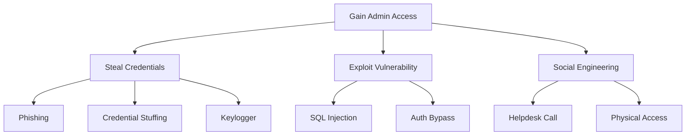

Cây tấn công là một phương pháp trực quan để phân tích cách kẻ tấn công có thể đạt được mục tiêu. Được phát minh bởi Bruce Schneier, chúng cung cấp một cách có cấu trúc để suy nghĩ về tất cả các đường tấn công có thể xảy ra—giúp bạn xác định các mối đe dọa có thể bị bỏ qua bằng phân tích tuyến tính.

Không giống như STRIDE (phân loại các mối đe dọa) hoặc DREAD (ưu tiên chúng), cây tấn công hiển thị các cuộc tấn công **how** xảy ra. Cấu trúc cây làm cho các tình huống tấn công phức tạp trở nên dễ hiểu và giúp xác định các liên kết yếu nhất trong hệ thống phòng thủ của bạn.

## Giải phẫu cây tấn công

Một cây tấn công bao gồm:

- **Root node**: Mục tiêu cuối cùng của kẻ tấn công
- **Các nút con**: Các mục tiêu phụ hoặc các bước cần thiết để đạt được nút gốc
- **Nút lá**: Hành động tấn công nguyên tử
- Cổng **AND/OR**: Cách kết hợp các mục tiêu phụ

### Cấu trúc cơ bản

```
                    [Attacker Goal]
                          |
            +-------------+-------------+
            |                           |
       [Sub-goal A]               [Sub-goal B]
            |                           |
      +-----+-----+               +-----+-----+
      |           |               |           |
   [Step 1]   [Step 2]       [Step 3]   [Step 4]
```

- Mối quan hệ **OR** (mặc định): Kẻ tấn công cần hoàn thành BẤT KỲ đứa trẻ nào để đạt được cha mẹ
- **AND mối quan hệ**: Kẻ tấn công phải hoàn thành TẤT CẢ con để đạt được cha mẹ

## Xây dựng cây tấn công đầu tiên của bạn

Hãy mô hình hóa một tình huống phổ biến: xâm phạm tài khoản quản trị viên của ứng dụng web.

### Bước 1: Xác định mục tiêu gốc

Bắt đầu với mục tiêu tấn công rõ ràng, cụ thể:

```
Goal: Gain Admin Access to Web Application
```

### Bước 2: Xác định các phương pháp tiếp cận cấp cao

Những cách chính để đạt được mục tiêu này là gì?

```
                    [Gain Admin Access]
                           |
         +-----------------+------------------+
         |                 |                  |
   [Steal Admin      [Exploit App      [Social Engineer
    Credentials]      Vulnerability]    Admin User]
```

### Bước 3: Phân tách từng phương pháp

Chia nhỏ từng cách tiếp cận cấp cao thành các vectơ tấn công cụ thể:

```
                         [Gain Admin Access]
                                |
         +----------------------+----------------------+
         |                      |                      |
   [Steal Admin           [Exploit App           [Social Engineer
    Credentials]           Vulnerability]         Admin User]
         |                      |                      |
    +----+----+            +----+----+            +----+----+
    |         |            |         |            |         |
 [Phishing] [Keylogger] [SQLi]  [Auth     [Pretexting] [Baiting]
                                 Bypass]
```

### Bước 4: Tiếp tục cho đến khi có hành động nguyên tử

Mở rộng cho đến khi bạn đạt được các hành động không thể phân tách một cách có ý nghĩa:

```
[Phishing]
    |
+---+---+
|       |
[Send   [Clone
 Email]  Login Page]
   |         |
   |    +----+----+
   |    |         |
   |  [Buy    [Setup
   |   Domain] Hosting]
   |
+--+---+
|      |
[Craft [Buy Victim
 Lure]  Email List]
```

## Ký hiệu cây tấn công

### Ký hiệu dựa trên văn bản

Để đánh giá tài liệu và mã, hãy sử dụng văn bản thụt lề:

```
Goal: Gain Admin Access
 OR
 |-- Steal Credentials
 |   OR
 |   |-- Phishing Attack
 |   |   AND
 |   |   |-- Create Fake Login Page
 |   |   |-- Send Convincing Email
 |   |   |-- Victim Enters Credentials
 |   |
 |   |-- Credential Stuffing
 |   |   AND
 |   |   |-- Obtain Leaked Password List
 |   |   |-- Admin Reuses Password
 |   |
 |   |-- Keylogger
 |       AND
 |       |-- Install Malware on Admin Machine
 |       |-- Admin Logs In
 |
 |-- Exploit Vulnerability
 |   OR
 |   |-- SQL Injection
 |   |   AND
 |   |   |-- Find Injectable Parameter
 |   |   |-- Extract Admin Password Hash
 |   |   |-- Crack Hash
 |   |
 |   |-- Authentication Bypass
 |       OR
 |       |-- JWT Algorithm Confusion
 |       |-- Session Fixation
 |
 |-- Social Engineering
     OR
     |-- Call IT Helpdesk
     |   AND
     |   |-- Impersonate Employee
     |   |-- Request Password Reset
     |
     |-- Physical Access
         AND
         |-- Tailgate into Office
         |-- Access Unlocked Workstation
```

### Ký hiệu YAML cho công cụ

```yaml
attack_tree:
  goal: "Gain Admin Access"
  type: OR
  children:
    - name: "Steal Credentials"
      type: OR
      children:
        - name: "Phishing Attack"
          type: AND
          cost: 500
          skill: 3
          children:
            - name: "Create Fake Login Page"
              leaf: true
              cost: 100
            - name: "Send Convincing Email"
              leaf: true
              cost: 50
            - name: "Victim Enters Credentials"
              leaf: true
              probability: 0.15
        
        - name: "Credential Stuffing"
          type: AND
          cost: 200
          children:
            - name: "Obtain Leaked Password List"
              leaf: true
              cost: 100
            - name: "Admin Reuses Password"
              leaf: true
              probability: 0.3
    
    - name: "Exploit Vulnerability"
      type: OR
      children:
        - name: "SQL Injection"
          type: AND
          skill: 5
          children:
            - name: "Find Injectable Parameter"
              leaf: true
              time_hours: 4
            - name: "Extract Admin Hash"
              leaf: true
            - name: "Crack Password Hash"
              leaf: true
              time_hours: 24
```

## Chú thích cây tấn công

Thêm thuộc tính vào các nút để kích hoạt phân tích định lượng:

### Thuộc tính chung

| Thuộc tính | Mô tả | Giá trị mẫu |
|-----------|-------------|----------------|
| **Cost** | Nguồn lực cần thiết (tiền, thời gian) | 100 USD, 4 giờ |
| **Kỹ năng** | Cần có chuyên môn kỹ thuật | thang điểm 1-10 |
| **Xác suất** | Khả năng thành công | 0.0 - 1.0 |
| **Khả năng phát hiện** | Cơ hội bị bắt | Thấp/Trung bình/Cao |
| **Điều kiện tiên quyết** | Điều gì phải xảy ra trước tiên | "Truy cập mạng" |

### Ví dụ có chú thích

```python
# Python representation for automated analysis
attack_tree = {
    'goal': 'Gain Admin Access',
    'type': 'OR',
    'children': [
        {
            'name': 'Phishing',
            'type': 'AND',
            'cost_usd': 500,
            'time_hours': 8,
            'skill_level': 3,
            'success_probability': 0.15,
            'detection_probability': 0.4,
            'children': [
                {'name': 'Setup fake domain', 'leaf': True, 'cost_usd': 15},
                {'name': 'Clone login page', 'leaf': True, 'time_hours': 2},
                {'name': 'Craft email', 'leaf': True, 'time_hours': 1},
                {'name': 'Victim clicks link', 'leaf': True, 'probability': 0.3}
            ]
        },
        {
            'name': 'SQL Injection',
            'type': 'AND',
            'cost_usd': 0,
            'time_hours': 12,
            'skill_level': 6,
            'success_probability': 0.8,  # If vuln exists
            'detection_probability': 0.6,
            'prerequisites': ['Vulnerable endpoint exists'],
            'children': [
                {'name': 'Find injectable param', 'leaf': True},
                {'name': 'Extract hash', 'leaf': True},
                {'name': 'Crack hash', 'leaf': True, 'time_hours': 24}
            ]
        },
        {
            'name': 'Insider Threat',
            'type': 'AND',
            'cost_usd': 10000,  # Bribe
            'skill_level': 1,
            'success_probability': 0.9,
            'detection_probability': 0.2,
            'children': [
                {'name': 'Identify disgruntled employee', 'leaf': True},
                {'name': 'Make offer', 'leaf': True},
                {'name': 'Employee provides access', 'leaf': True}
            ]
        }
    ]
}
```

## Phân tích cây tấn công

### Tìm đường tấn công rẻ nhất

Đối với các nút OR, lấy giá trị con có chi phí tối thiểu. Đối với các nút AND, tính tổng tất cả các nút con:

```python
def calculate_min_cost(node):
    """Calculate minimum cost to achieve this node."""
    if node.get('leaf'):
        return node.get('cost_usd', 0)
    
    child_costs = [calculate_min_cost(child) for child in node['children']]
    
    if node['type'] == 'OR':
        return min(child_costs)
    else:  # AND
        return sum(child_costs)

# For our example:
# - Phishing: $500 (fixed campaign cost)
# - SQL Injection: $0 (just needs skill)
# - Insider: $10,000 (bribe)
# Minimum: SQL Injection at $0
```

### Tìm đường tấn công dễ nhất

Xem xét cả kỹ năng và xác suất thành công:

```python
def find_easiest_path(node, current_path=None):
    """Find attack path with lowest skill requirement and highest success."""
    current_path = current_path or []
    
    if node.get('leaf'):
        return [node['name']], node.get('skill_level', 1)
    
    if node['type'] == 'OR':
        # Find child with lowest skill requirement
        best_path = None
        best_skill = float('inf')
        
        for child in node['children']:
            path, skill = find_easiest_path(child)
            if skill < best_skill:
                best_skill = skill
                best_path = [child['name']] + path
        
        return best_path, best_skill
    
    else:  # AND - must do all, take max skill
        all_paths = []
        max_skill = 0
        
        for child in node['children']:
            path, skill = find_easiest_path(child)
            all_paths.extend(path)
            max_skill = max(max_skill, skill)
        
        return all_paths, max_skill
```

### Xác định các nút quan trọng

Các nút xuất hiện trong tất cả các đường tấn công đều rất quan trọng—làm cứng chúng sẽ chặn được nhiều cuộc tấn công:

```python
def find_all_paths(node, current_path=None):
    """Generate all possible attack paths."""
    current_path = current_path or []
    
    if node.get('leaf'):
        yield current_path + [node['name']]
        return
    
    if node['type'] == 'OR':
        for child in node['children']:
            yield from find_all_paths(child, current_path + [node['name']])
    else:  # AND
        # For AND, we need all children in the path
        child_paths = [list(find_all_paths(c, [])) for c in node['children']]
        # Combine all possibilities (Cartesian product)
        from itertools import product
        for combo in product(*child_paths):
            combined = current_path + [node['name']]
            for path in combo:
                combined.extend(path)
            yield combined

def find_critical_nodes(attack_tree):
    """Find nodes that appear in ALL attack paths."""
    paths = list(find_all_paths(attack_tree))
    
    if not paths:
        return set()
    
    # Start with all nodes in first path
    critical = set(paths[0])
    
    # Intersect with all other paths
    for path in paths[1:]:
        critical &= set(path)
    
    return critical
```

## Tấn công cây cho các tình huống chung

### Ví dụ 1: Lọc dữ liệu

```
Goal: Exfiltrate Customer Database
 OR
 |-- External Attack
 |   OR
 |   |-- Exploit Public-Facing App
 |   |   AND
 |   |   |-- Find RCE Vulnerability
 |   |   |-- Establish Reverse Shell
 |   |   |-- Locate Database
 |   |   |-- Exfil via Encrypted Channel
 |   |
 |   |-- Compromise Cloud Account
 |       AND
 |       |-- Obtain AWS Keys (leaked in repo)
 |       |-- Access S3 Backup Bucket
 |       |-- Download Database Dump
 |
 |-- Insider Threat
 |   OR
 |   |-- Malicious Admin
 |   |   AND
 |   |   |-- Admin Exports Data
 |   |   |-- Transfers to Personal Device
 |   |
 |   |-- Compromised Endpoint
 |       AND
 |       |-- Malware on Employee Laptop
 |       |-- Intercept Database Credentials
 |       |-- Connect via VPN
 |       |-- Query and Exfil Data
 |
 |-- Physical Access
     AND
     |-- Gain Building Access
     |-- Find Unattended Workstation
     |-- Connect USB Device
     |-- Copy Database
```

### Ví dụ 2: Tấn công chuỗi cung ứng

```
Goal: Inject Malicious Code into Product
 OR
 |-- Compromise Source Repository
 |   OR
 |   |-- Steal Developer Credentials
 |   |   AND
 |   |   |-- Phish Developer
 |   |   |-- Bypass MFA (SIM swap/push fatigue)
 |   |   |-- Push Malicious Commit
 |   |
 |   |-- Compromise CI/CD Pipeline
 |       AND
 |       |-- Access Jenkins/GitHub Actions
 |       |-- Modify Build Script
 |       |-- Inject During Build
 |
 |-- Compromise Dependency
 |   OR
 |   |-- Typosquatting
 |   |   AND
 |   |   |-- Register Similar Package Name
 |   |   |-- Developer Makes Typo
 |   |
 |   |-- Compromise Legitimate Package
 |       AND
 |       |-- Take Over Maintainer Account
 |       |-- Push Malicious Update
 |
 |-- Compromise Build Infrastructure
     AND
     |-- Access Build Server
     |-- Modify Compiler/Toolchain
     |-- Inject at Compile Time
```

## Tích hợp cây tấn công với STRIDE/DREAD

Sử dụng đồng thời cả ba phương pháp:

1. **STRIDE**: Phân loại các loại mối đe dọa tồn tại
2. **Attack Trees**: Lập mô hình cách nhận ra từng mối đe dọa
3. **DREAD**: Ưu tiên đường tấn công nào cần phòng thủ trước

```python
# Combined threat model
threat = {
    'name': 'Admin Account Compromise',
    'stride_category': 'Spoofing / Elevation of Privilege',
    'attack_tree': attack_tree,  # From above
    'dread': {
        'damage': 9,
        'reproducibility': 7,
        'exploitability': 6,
        'affected_users': 10,
        'discoverability': 5
    },
    'analysis': {
        'cheapest_path': 'SQL Injection',
        'min_cost': 0,
        'easiest_path': 'Phishing',
        'critical_controls': [
            'MFA on admin accounts',
            'Input validation',
            'Security awareness training'
        ]
    }
}
```

## Công cụ mô hình cây tấn công

### Công cụ dựa trên văn bản

- **PlantUML**: Tạo sơ đồ từ văn bản
- **Mermaid**: Sơ đồ tương thích với Markdown
- **Graphviz**: Trực quan hóa biểu đồ mạnh mẽ

### Ví dụ về nàng tiên cá



### Công cụ cây tấn công chuyên dụng

- **ADTool**: Công cụ học thuật cho cây tấn công-phòng thủ
- **Threagile**: Mô hình hóa mối đe dọa dựa trên mã
- **Công cụ tạo mô hình mối đe dọa của Microsoft**: Công cụ GUI miễn phí
- Mối đe dọa **OWASP Dragon**: Ứng dụng web nguồn mở

## Thực tiễn tốt nhất

### Làm:

- Bắt đầu với mục tiêu rõ ràng, cụ thể
- Liên quan đến nhiều quan điểm (dev, ops, security)
- Cập nhật cây khi hệ thống phát triển
- Tập trung vào các kịch bản tấn công thực tế
- Chú thích với chi phí và xác suất

### Đừng:

- Tạo cây quá chi tiết (có thể quản lý được)
- Hãy quên đi những mối đe dọa nội bộ
- Bỏ qua các vectơ tấn công vật lý
- Dừng lại ở lý thuyết—xác thực bằng thử nghiệm bút
- Tạo một lần và không bao giờ cập nhật

## Tóm tắt

Cây tấn công cung cấp một cách trực quan, có hệ thống để mô hình hóa các mối đe dọa:

- **Root node**: Kẻ tấn công muốn gì?
- **Các nút con**: Làm thế nào họ có thể đạt được điều đó?
- Cổng **OR**: Kẻ tấn công cần bất kỳ một đường dẫn nào
- Cổng **AND**: Kẻ tấn công cần tất cả các bước phụ
- **Annotations**: Chi phí, kỹ năng, xác suất phân tích

Sử dụng cây tấn công để:

1. Khám phá các đường tấn công mà bạn chưa từng xem xét
2. Xác định các biện pháp kiểm soát quan trọng chặn nhiều đường dẫn
3. Truyền đạt các mối đe dọa cho các bên liên quan phi kỹ thuật
4. Ưu tiên đầu tư an ninh

Trong phần tiếp theo, chúng tôi sẽ áp dụng mọi điều đã học được vào các bài tập thực hành lập mô hình mối đe dọa.
